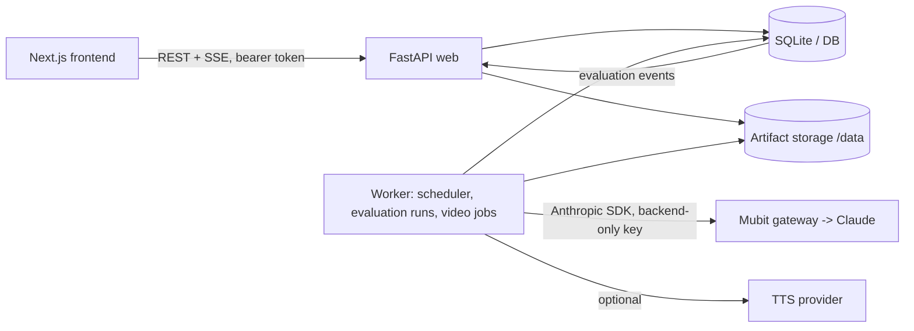

# EvalForgeAI

Mubit-centred AI quality testing and evaluation platform. Version 3.0 adds a live analytics dashboard, PDF evaluation reports and Claude-assisted video briefings on top of the existing FastAPI + Next.js application.

## Features

| Area | Status |
|---|---|
| Live dashboard: KPI catalogue (24 KPIs), weighted Overall Quality Index, N/A with reasons, filters, comparisons, drill-down, charts | Implemented |
| Live updates: snapshot + SSE with event ids, dedupe, backoff reconnect, resync, polling fallback, stale indicator, pause/resume | Implemented |
| Scheduled evaluations (daily/weekly/dataset/regression) with overlap/duplicate/daily-cap protection, admin enable/disable | Implemented |
| Immutable report snapshots, 3 PDF templates (Executive, Technical, Statistical), persistent storage, history, regenerate | Implemented |
| Claude storyboards via Mubit (schema + deterministic grounding, human review/edit) | Implemented, **tested with mocks only** (no live Mubit verification) |
| Silent MP4 (Pillow + FFmpeg, 16:9, 1080p default), background worker, cancel/retry/timeouts | Implemented |
| Narrated MP4 via pluggable TTS provider | Experimental (verified with a mock provider only) |
| Remotion renderer | Not implemented (renderer is pluggable) |
| Object-storage backend, PostgreSQL | Not provided / untested |

See [docs/dashboard.md](docs/dashboard.md), [docs/pdf-reporting.md](docs/pdf-reporting.md), [docs/video-generation.md](docs/video-generation.md), [docs/mubit-integration.md](docs/mubit-integration.md), [docs/deployment.md](docs/deployment.md), [docs/security.md](docs/security.md) and the [audit](docs/dashboard-reporting-audit.md).

## Architecture



Reports: results → immutable snapshot → PDF (web process, background task) → video job (worker) → storyboard → review → render → MP4. Full diagram in [docs/video-generation.md](docs/video-generation.md).

## Quick start

### Docker

```bash
cp .env.example .env          # set EVALFORGE_API_KEYS=mytoken:me:admin (long random token)
docker compose up --build     # API :8000, UI :3000, worker, volume evalforge-data
```
Open the UI, enter the token. See [docs/deployment.md](docs/deployment.md).

### Local

```bash
cd backend && pip install -r requirements-dev.txt
APP_ENV=development EVALFORGE_API_KEYS=dev:me:admin uvicorn app.main:app --reload
python -m app.worker                 # separate terminal
cd frontend && npm install && npm run dev
```

## Configuration

All backend settings are environment variables (`.env.example`, `backend/app/config.py`). Key ones:

* `EVALFORGE_API_KEYS` – `token:user:role,…` (required; `AUTH_DISABLED` only works with `APP_ENV=development`).
* `MUBIT_API_KEY`, `MUBIT_ANTHROPIC_BASE_URL`, `MUBIT_ANTHROPIC_MODEL`, token/retry/rate budgets – Claude via Mubit; without a key, rule-based storyboards are used. Backend-only.
* `TTS_PROVIDER` (`none`|`http`), `TTS_ENDPOINT_URL`, `TTS_API_KEY` – optional narration.
* `DATABASE_URL`, `ARTIFACT_DIR` – persistence (mount a volume).
* `VIDEO_*`, `WORKER_*`, `QUALITY_INDEX_WEIGHTS_JSON` – limits and tuning.

## Metrics catalogue

LLM: answer correctness, factual precision, hallucination rate, instruction adherence, response consistency. RAG: faithfulness, context precision/recall, answer relevancy, citation accuracy, retrieval NDCG@K. Agent: task completion, tool-use accuracy, recovery success. Operations: failure rate, median/P95 latency, tokens, cost, cost per successful evaluation, regression alerts, confidence intervals, run counts. Metrics with insufficient observations or no evaluator show `N/A` and the reason; nothing is invented. Only some metrics have built-in evaluators – others appear once observations are ingested (`POST /api/v1/evaluations/…`). Quality Index: weighted mean of available metrics with weights re-normalised; N/A below coverage/sample thresholds ([docs/dashboard.md](docs/dashboard.md)).

## API (all under `/api/v1`, bearer auth except `/health`)

Dashboard `overview|metrics|trends|events|alerts`; Reports `GET/POST /reports`, `/{id}`, `/{id}/download`, `/{id}/snapshot`; Videos `POST/GET /videos`, `/{id}`, `/{id}/approve|render|cancel|download`. Interactive docs at `/docs`.

## Tests and CI

```bash
cd backend && python -m pytest -q          # includes end-to-end results → snapshot → PDF → storyboard → silent MP4
cd frontend && npm test && npm run lint && npm run build
```
Paid services (Mubit/Claude, TTS) are mocked. `.github/workflows/ci.yml` runs tests and image builds; `docker-publish.yml` publishes to GHCR (`ghcr.io/helloagit/evalforgeai`, `-worker`, `-frontend`) on `main` and `v*` tags. The workflows had not run when this was written.

## Limitations

See each doc; main points: Claude/Mubit route unverified against a live gateway; Remotion not used; narrated mode verified with a mock only; SQLite single-host by default; token auth only (no user management or per-project ACLs); PDF layout verified structurally, not by visual review; no browser end-to-end UI tests. **Credentials committed in earlier history must be rotated** ([docs/security.md](docs/security.md)).
