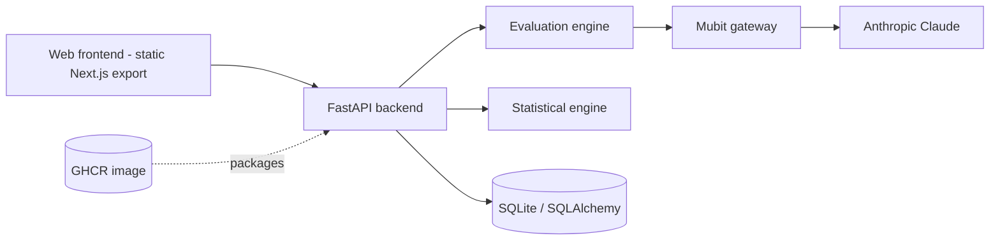

# EvalForgeAI — AI Testing, Evaluation and Statistical Quality Intelligence

[](https://github.com/HelloAGit/EvalForgeAI/actions/workflows/ci.yml)
[](LICENSE)

EvalForgeAI is an early-stage (pre-0.1.0) platform for assessing LLM, RAG and agent quality, with Mubit as the intended model gateway.

## Problem
AI teams need reliable evaluations, RAG grounding measurements, agent workflow validation, model comparisons, statistical uncertainty, cost/latency tracking and regression testing.

## Implemented capabilities
- FastAPI backend with health endpoints (`/health`, `/api/v1/health`) and Mubit status check (`/api/v1/mubit/status`).
- Metric helpers for LLM, RAG and agent evaluation and a native statistics engine (SciPy/Statsmodels) — see `backend/tests`.
- Next.js dashboard homepage. **The dashboard values come from static demo data and are labelled "Simulated Data Mode"; they are not measured results.**
- Optional MLStatSoft adapter stub (experimental, disabled by default).

Not yet implemented: the other pages linked in the sidebar, evaluation run persistence, charts/filters, report export. See `docs/repository-audit.md`.

## Architecture


## Layout
`backend/` FastAPI app, services, tests · `frontend/` Next.js app · `datasets/` sample data · `docs/` audit and release docs · `Dockerfile` single image (frontend is built statically and served by the backend) · `.github/workflows/` CI and publish.

## Local setup
```bash
make setup
cp .env.example .env   # add MUBIT_API_KEY locally; never commit it
make run-backend       # http://localhost:8000
make run-frontend      # http://localhost:3000
make test
```
Frontend checks: `cd frontend && npm ci && npm run lint && npm run typecheck && npm run build`.

## Docker
```bash
docker build -t evalforgeai .
docker run --rm -p 8000:8000 -e MUBIT_API_KEY="$MUBIT_API_KEY" evalforgeai
docker compose up --build
# once the publish workflow has succeeded and the package is accessible:
docker pull ghcr.io/helloagit/evalforgeai:latest
```
UI and API are served on one port at http://localhost:8000. The container binds `0.0.0.0`, honours `PORT`, and runs as a non-root user.

## Configuration
| Variable | Purpose | Default |
|---|---|---|
| `MUBIT_API_KEY` | Server-side Mubit key | empty (unconfigured) |
| `MUBIT_ANTHROPIC_BASE_URL` | Mubit Anthropic gateway | `https://api.mubit.ai/anthropic` |
| `MUBIT_ANTHROPIC_MODEL` | Claude model | `claude-haiku-4-5` |
| `DATABASE_URL` | SQLAlchemy URL | `sqlite:///./evalforge.db` |
| `PORT` | Listen port | `8000` |
| `STATIC_DIR` | Directory of the exported frontend to serve | unset (set in image) |
| `MLSTATSOFT_ENABLED` / `MLSTATSOFT_API_KEY` | Optional stats integration | disabled |

## CI/CD
- `CI` (`ci.yml`): PRs to and pushes on `main` — backend import check and tests, frontend lint/typecheck/build, Docker build, container health check, Trivy scan.
- `Publish GHCR image` (`publish-ghcr.yml`): on `main`, `v*.*.*` tags and manual dispatch; runs tests, health-checks a candidate image, then pushes `linux/amd64` to `ghcr.io/helloagit/evalforgeai`. See `docs/releasing.md` for tags. Package page: https://github.com/HelloAGit/EvalForgeAI/pkgs/container/evalforgeai (visibility defaults to private; change it in package settings). Publishing has not been confirmed until the workflow run succeeds.

## Troubleshooting
- **npm build fails**: use Node 20 and `npm ci` in `frontend/`.
- **Missing Python modules**: `pip install -r backend/requirements.txt`.
- **Entrypoint errors**: the app is `app.main:app`, run from `backend/`.
- **Mubit shows unconfigured/failed**: set `MUBIT_API_KEY` in the environment.
- **GHCR permission denied**: check package visibility and that the repository is linked to the package.
- **Health check fails / Cloud Run**: the app must listen on `$PORT`; check `docker logs`.
- **Database errors**: verify `DATABASE_URL` and that `/app/data` is writable.

## Roadmap
Additional pages and metrics, run persistence, Mubit retries/metadata capture, decision attribution, continuous evaluation, advanced statistics, MLStatSoft integration, access controls.

## License
MIT
