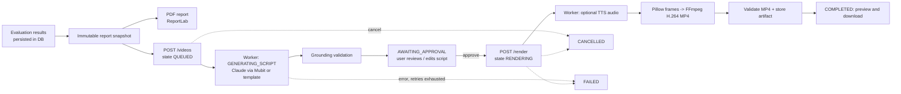

# Report-to-video generation

## Renderer choice

The implemented renderer is **Pillow + FFmpeg** (`services/video_renderer.py`), run by the worker process. **Remotion was not implemented.** Reasons: Remotion needs Node + headless Chromium in the worker image and has a company-licence requirement for larger teams; the Pillow/FFmpeg path needs only the bundled static FFmpeg from `imageio-ffmpeg`. The renderer sits behind a small `render(payload, storyboard, out_path, **opts)` interface so a Remotion backend can be added later.

Output: H.264 MP4, 16:9, `VIDEO_WIDTH`×`VIDEO_HEIGHT` (default 1920×1080), `VIDEO_FPS` (30), `yuv420p`, `faststart`. Scenes: title, KPI cards (count-up animation ending on the exact snapshot value), LLM / RAG / agent bar charts with confidence-interval ticks and N/A rows, failures, statistical findings, recommendations, closing; crossfade transitions; optional captions timed to the narration. Static frames are cached so a 2-minute video does not redraw every frame.

## Options (`POST /api/v1/videos`)

`report_id`, `duration_seconds` (60/120/180 – a target; scene durations are scaled, and extended if narration is longer), `mode` (`silent` | `narrated`), `voice`, `captions`, `sections` (subset of the scene types; title and closing are always kept).

## Job states and APIs

`QUEUED → GENERATING_SCRIPT → AWAITING_APPROVAL → RENDERING → COMPLETED`, plus `FAILED` and `CANCELLED`. Rendering is never done in a request handler.

`POST /videos`, `GET /videos`, `GET /videos/capabilities`, `GET /videos/{id}`, `PUT /videos/{id}/storyboard` (edit), `POST /videos/{id}/approve`, `POST /videos/{id}/render`, `POST /videos/{id}/cancel`, `GET /videos/{id}/download` (`video/mp4`). All require authentication; only the owner or an admin can access a job.

Worker behaviour (`services/video_worker.py`, `app/worker.py`): atomic claims with leases (several workers are safe; a crashed worker's job is recovered after `WORKER_LEASE_SECONDS`), `VIDEO_MAX_ATTEMPTS` retries for transient errors (not for timeouts, TTS configuration errors or approval errors), `VIDEO_RENDER_TIMEOUT_SECONDS`, cooperative cancellation (checked at least once per video-second; FFmpeg is killed and no artifact is stored), progress updates, temp-directory cleanup, `VIDEO_MAX_DURATION_SECONDS` and `VIDEO_MAX_ACTIVE_PER_USER` limits. The render only starts for a storyboard whose hash matches the approved hash.

Validation before publishing: `ftyp` header, H.264 codec, expected resolution, runtime within tolerance, audio track present only in narrated mode, full decode with FFmpeg without errors.

## Narration

Claude does **not** produce audio. Narrated mode uses a pluggable `TTSProvider` (`services/tts.py`): `none` (default – narrated mode rejected), `http` (generic: POSTs `{"text","voice"}` to `TTS_ENDPOINT_URL`, expects 16-bit PCM WAV; credentials in `TTS_API_KEY`), and a `MockTTS` for tests. Subclass `TTSProvider` to add a vendor. Audio is concatenated per scene, scene durations extend to fit speech (+0.6 s), and the track is muxed as AAC. The `http` provider has been tested only against the mock interface, not a real speech service.

## Limitations

* Silent mode is the fully verified path. Narrated mode is verified with the mock provider only.
* The default 1920×1080×30 fps render of a 2-minute video was not benchmarked; a short 1080p sample was rendered and inspected during development. Size the worker (`WORKER_CPUS`, `WORKER_MEM_LIMIT`) accordingly.
* Fonts: DejaVu Sans if installed (worker image installs it), otherwise Pillow's built-in font.
